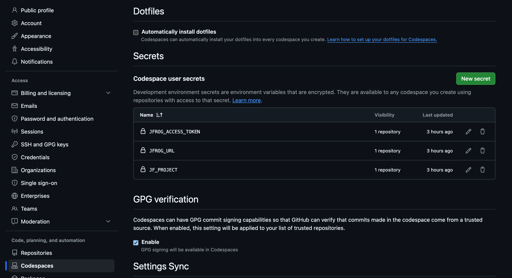

personal -> settings -> Codespaces



在终端执行下面命令检查
```
node -e 'for (const k of ["JFROG_URL","JFROG_ACCESS_TOKEN","JF_PROJECT"]) console.log(k + ": " + (process.env[k] ? "已设置" : "未设置"))'
```

安装 JFrog Agent Plugin
```
npx --yes \
  --registry "https://releases.jfrog.io/artifactory/api/npm/coding-agents-npm/" \
  @jfrog/agent-guard \
  --list-available \
  --project "$JF_PROJECT"
```


