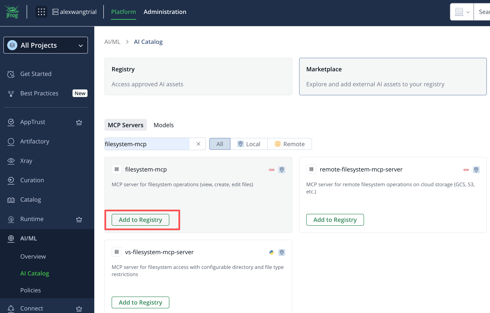
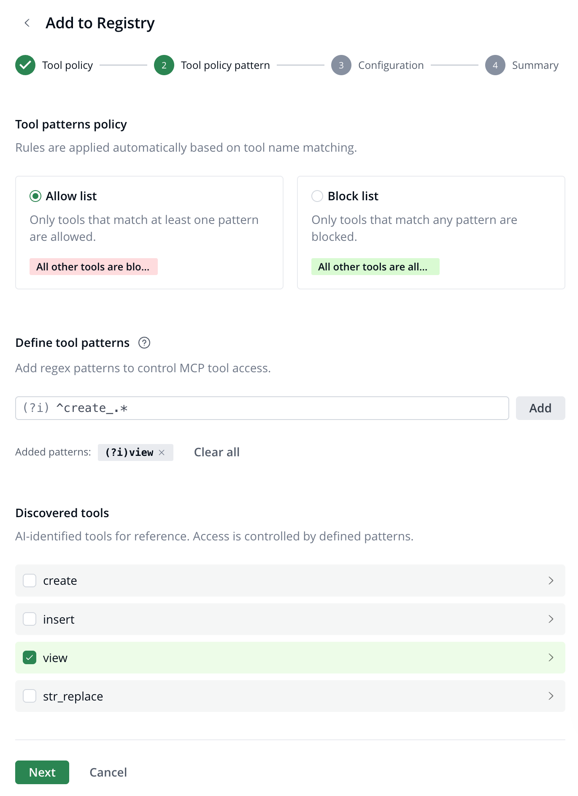
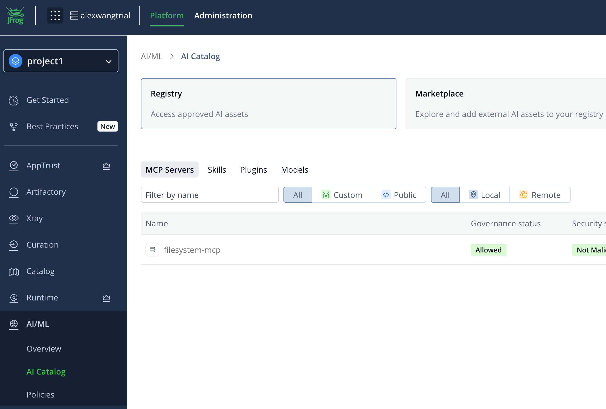
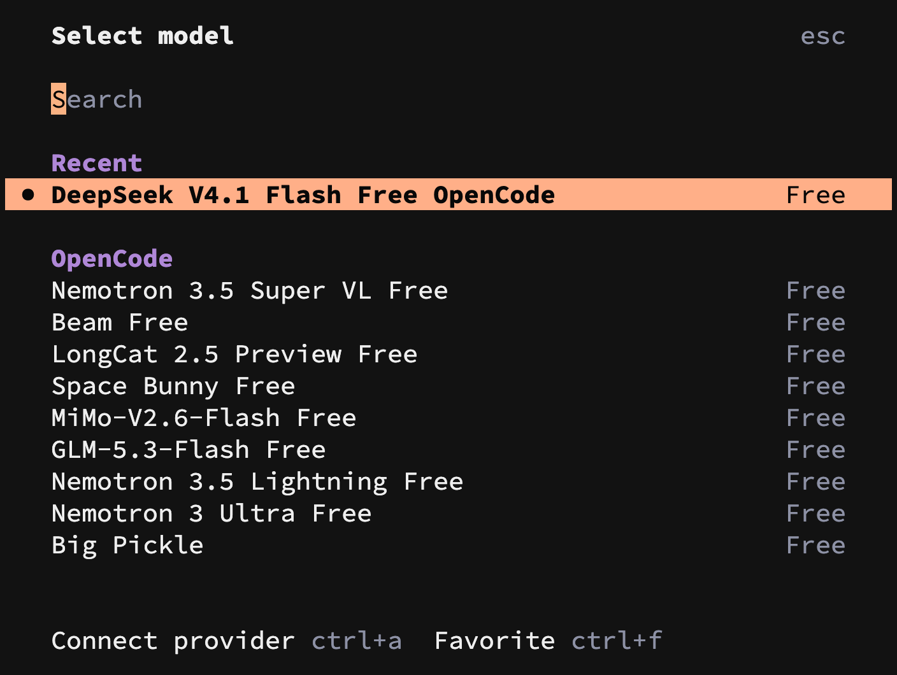
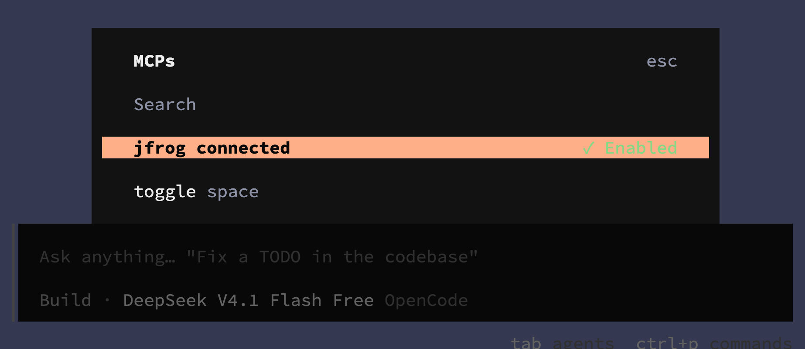
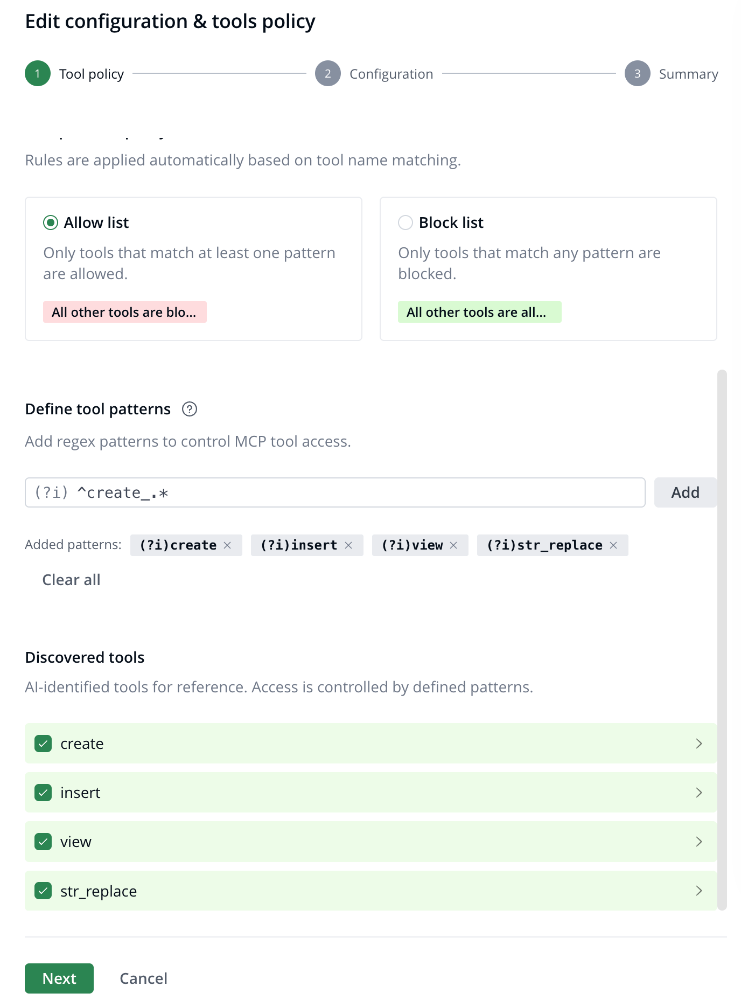

# 标题 Lab 01 MCP Server 治理

## 01 MCP Market Place MCP 准入配置
以管理员身份登陆平台，进入 AI/ML -> AI Catalog  Marketplace 搜索需要管制的 MCP Server（本次使用 filesystem-mcp）
点击 Add to Registry



选择您需要使用 MCP 用户所在的 Project，选择 【Select tools manually】,
选择 Allow list tool view



选择 ProjectN，在 Registry 中可以查看到刚才配置的 MCP Server


## 02 通过 OpenCode 使用 MCP Server
### Step 1: opencode 配置
cd %WORK_DIR%/jfrog-ai-workshop/user
opencode
输入 /modes 
选择截图模型



### Step 2: opencode 添加 JFrog Agent Guard
jfrog-ai-workshop/user 目录添加 OpenCode 项目级配置文件 opencode.json
```
vim opencode.json

{
  "plugin": ["@jfrog/opencode-jfrog-plugin"]
}
```

认证 JFrog MCP Server
```
opencode mcp auth jfrog
```

检测 JFrog Agent Guard 配置是否完成
```
/skills

/mcps
```


### Step 3: 利用 OpenCode 使用 MCP Server
Prompt 直接输入以下内容
```
我有哪些 mcp server 可以使用
```

```
安装 filesystem-mcp 
```

```
安装 mongodb mcp server
```
由于 mongodb mcp server 不在准入列表中，因此会报错

```
使用 filesystem-mcp 读取 workshop.md，显示实际文件内容。
```

```
使用 filesystem-mcp 创建文件 test.txt
```
由于只开放了 view tool，因此会报错



